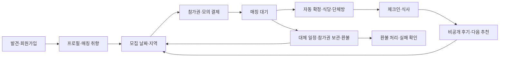

# PRD·사용자·운영자 흐름 교차 검토와 개선

2026-10-19 UTC. 기준 커밋 `702bd8a`와 이번 작업 트리. 운영 DB·배포는 변경하지 않았다.

## 판단

신청부터 재참여까지 핵심 흐름은 연결되어 있지만, 정상 화면의 완성도에 비해 **결제 후 예외·재시도·협업 중 입력 보존**에 공백이 있었다. 화면의 주요 상태·다음 행동을 보완하고, 교차 검토에서 발견한 중복 보상 경로를 서버에서 차단했다. 이는 PRD 전체 무결함이나 실제 사용자의 만족도 보증은 아니다.

원본은 `files/우연한식탁_PRD.pdf` v0.2 12쪽이다. 기존 감사·추적표·최신 성비 정책을 읽고, 화면 → API → 서비스 → 워커 → 회귀 검사를 대조했다. 기존 검증 기록은 이번 실행 결과와 구분했다.

## 두 검토자의 역할과 스킬

- Codex: 원본 PRD 대조, 코드 검토, 개선 구현, 격리 DB 테스트, 실제 production bundle 브라우저 검증.
- Claude: 로컬 Claude Code CLI에서 주 검토 모델 `claude-opus-5-5`를 지정해 반복 검토. 최초 검토의 결론을 그대로 채택하지 않고 코드·재현으로 확인했다. Claude 자신은 정적 검토를 수행했으며 테스트·브라우저 실행자는 Codex다.
- 최초 제한 환경의 API 연결 실패는 성공 검토로 세지 않았다. 연결 재개 후 동일 Claude 세션에서 검토를 이어갔다. CLI 메타데이터에는 보조 `claude-haiku-5-5` 사용량도 있으나 주 검토 응답 모델은 Opus 5.5로 확인했다.
- 이미 설치된 [Vercel Web Interface Guidelines 스킬](https://github.com/vercel-labs/agent-skills/tree/main/skills/web-design-guidelines)과 [Anthropic webapp-testing 스킬](https://github.com/anthropics/skills/tree/main/skills/webapp-testing)을 사용하고 Claude에도 해당 `SKILL.md` 경로를 전달했다. 적합한 스킬이 있어 중복 설치하지 않았다. [최신 인터페이스 기준](https://github.com/vercel-labs/web-interface-guidelines/blob/main/command.md)도 조회했다.
- Next.js 코드 수정 전 설치된 `node_modules/next/dist/docs/`의 폼·Playwright 가이드를 읽었다.

## 참가자 흐름



| 단계 | 확인한 설계·이번 보완 |
|---|---|
| 발견·홈 | 모집과 이미 신청한 만남을 구분. 대체 일정 선택·결제/환불 확인 카드를 추가. 내 만남 API 실패도 안내·재시도 제공 |
| 가입·프로필 | 단계 이동·답변 보존·저장·재사용을 실제 모바일 가입으로 확인. 성별 미선택 프로필 저장은 허용하지만 현행 성비 정책상 신청 전 선택 필요를 안내 |
| 날짜·지역 | 실제 공개 모집을 사용. 모든 선택 날짜·지역이 적어도 하나의 공개 조합에 연결되는지 화면·checkout API·신청 서비스가 같은 함수로 검증 |
| 결제 | 실패 시 재시도, 승인·참가권·원장 멱등성. 만료된 결제 세션 재사용 방지. 미선택 성별의 결제와 유료 신청 후 미선택 변경 차단 |
| 대기·실패 | 마감·다음 안내와 대체 일정·보관·환불 제공. 환불·보관 선택 전 확인. 환불 선택 이후 다른 보상으로 전환하지 못하도록 서버 검증 |
| 확정·안내 | 식당·예약명·지도·멤버·채팅·콘텐츠·체크인 연결. 식탁에서 본인 신청 취소 안내로 이동하는 링크 추가 |
| 취소 | 신청 상세에 사유·48시간 정책·복원/환불 안내·최종 확인 추가. 환불 진행·실패 후 다른 탭의 취소 요청도 서버에서 차단 |
| 안전·후기 | 행사 전에도 식탁에서 신고·차단 가능, 채팅에서 연결. 후기 작성은 실제 참석 확인 기준을 유지 |
| 재참여·설정 | 새 모집 알림 저장 실패를 표시하고 기존 서버 확인 상태를 유지. 재시도 제공 |

## 운영자 흐름

여섯 주요 메뉴(신청 중·만남 예정·지난 만남·식당/예약·문의함·운영 현황)를 유지한다. 모집·매칭 기준·팀·운영 설정은 보조 메뉴, 참석·안내 이력은 식탁 상세 맥락에 둔다. 이 배치는 기존 합의된 제품 설계이며 PRD의 운영 기능별 독립 메뉴를 그대로 재현하는 방식과 구분한다.

1. 회차·식당 슬롯·매칭 기준·안내 템플릿 설정.
2. 신청·결제·마감 현황 확인 → 정상 조합은 자동 확정.
3. 식당 부족·예약·취소·신고 등 예외를 해당 맥락에서 처리.
4. **자동 처리 확인**에서 최종 실패 작업을 조회·재시도·해결 기록. 기존 리다이렉트를 없애고 설정·운영 현황에서 연결했다.
5. 재실패는 기존 예외를 다시 열고 성공하면 해결 완료로 정리. 미해결 항목을 먼저 조회한다.
6. 예약을 동료가 수정해도 작성 중인 초안을 보존하고, 이전 버전으로 덮어쓰지 못하도록 차단. 최신 예약 불러오기는 명시적으로 확인한다.
7. 식탁 긴급 재구성에서 새 식탁 수를 실제로 줄여 3명+3명 병합 구성을 제출할 수 있게 했다. 서버의 인원·연령·성비·제외 관계·동의 범위 검증은 유지한다.

## 교차 검토에서 잡은 핵심 반례

| 반례 | 서버·화면 개선 | 근거 |
|---|---|---|
| 선택 날짜 하나만 유효하고 나머지 날짜/지역에는 모집 없음 | 일관된 조합 검증. 결제 단계 전 안내 및 서버 거부 | `tests/recruitment-selection.test.ts`, 실제 checkout API 브라우저 검사 |
| 미선택 성별로 결제 후 영구 미매칭 | 결제 서비스 사전 거부·신청 화면 안내·유료 대기 신청 중 성별 제거 거부 | `tests/prd-completion.test.ts` |
| 동료 예약 변경 후 30초 새로고침으로 메모 소실 | 초안·작성 기준 버전 보존, 충돌 안내·덮어쓰기 차단 | `tests/cross-review-browser.py` |
| 채팅 새로고침 한 번 실패해 입력 소실 | 기존 자료가 있으면 화면 유지·오류 배너·재시도 | 같은 브라우저 검사 |
| 환불 최종 실패 후 HOLD/TRANSFER, 운영자 환불 재시도 | 환불 선택을 서버에서 고정. 환불 완료 직전 해결 선택·상태를 잠금 후 재검증 | `tests/virtual-payments.test.ts` |
| 환불 선택 후 다른 탭의 취소 API가 참가권 복원 | 취소 트랜잭션에서도 환불 선택·결제 상태 검사. 복원 허용 상태 제한 | 같은 테스트에서 SINGLE/THREE_PASS × 환불 대기/실패 직접 API 요청 |
| 재시도 성공 후 예외 RETRYING 고착, 재실패 후 중복 | 워커 성공 시 해결, 재실패 시 동일 예외 재개 | SQLite·PostgreSQL integration tests |

환불 관련 수정은 화면에서 버튼을 숨기는 것으로 끝내지 않았다. 해결 API, 취소 API, 환불 완료 함수와 워커 상태를 함께 검증한다. 완료된 환불의 재실행은 기존 결과만 반환하고 원장에 환불을 중복 기록하지 않는다.

## 점수와 반복 검토

각 항목은 1~5점이며 동일한 다섯 항목을 반복 평가했다. 점수는 Claude의 정적 설계 평가로, 테스트 통과율이나 사용자 만족도 측정치가 아니다. 개선 중 새 결함을 발견하면 점수를 낮추거나 유지했다.

| 항목 | 1차 | 2차 | 3차 | 최종 |
|---|---:|---:|---:|---:|
| PRD 부합 | 3.5 | 4 | 4 | 4 |
| 참가자 편의 | 3 | 3.5 | 3.5 | 3.5 |
| 운영자 편의 | 2.5 | 3 | 3.5 | 3.5 |
| 접근성 | 3 | 3.5 | 3.5 | 3.5 |
| 신뢰성 | 3.5 | 3 | 3 | 3.5 |

2차의 신뢰성 하락은 환불 실패와 다른 보상의 중복 가능성 때문이다. 3차에서는 같은 위험이 취소 API에도 남아 있음을 확인해 추가로 수정했다. 4차에서는 검토한 코드 범위의 잔여 HIGH를 발견하지 않았다고 판정했다. 평균은 3.1 → 3.4 → 3.5 → 3.6/5다. 마지막 평가 당시 실행 검사가 진행 중이었으므로, 이후 검사 성공만으로 점수를 임의로 올리지 않았다. [Claude 원문 4회](CLAUDE_CROSS_REVIEW_20261019.md)에 하락·보류·최종 판정을 모두 보존한다.

## 실행 검증

이번 실행 결과다. 로그·세션·DB·캡처는 Git 제외 `.data/cross-review/`에 둔다.

| 검사 | 결과·범위 |
|---|---|
| 전체 PostgreSQL 구성 | 95 통과, 실패 0, 건너뜀 0. 마지막 취소 가드 전 통합 스냅샷 |
| 취소/환불 마지막 가드 PostgreSQL | 10 통과, 실패 0. SINGLE·THREE_PASS 대기/실패 직접 취소 거부 포함 |
| 취소/환불 마지막 가드 SQLite | 10 통과, 실패 0 |
| 전체 SQLite 기본 구성 | 96개 중 91 통과, 실패 0, PostgreSQL 전용 5개 건너뜀 |
| production build | 마지막 취소 가드 포함 `npm run build` 통과. TypeScript 검사 포함 |
| production browser 교차 검토 시나리오 | 마지막 bundle 14 시나리오 통과, JavaScript 오류 0. 360·390·430·1440px 결제 화면 검사 포함 |
| 실제 가입·프로필 브라우저 | 360·390·430px, 27 확인 통과. 입력 누락·이전 단계·답변 보존·저장·프로필 재사용·성별 미선택 신청 사전 차단 |

브라우저 시나리오 중 결제/환불·장애·동시 편집·병합의 특정 상태는 API 응답 통제로 재현한다. 실제 돈 이동·실제 동시 운영자 테스트라고 해석하지 않는다. 실제 checkout 거부와 예외 목록 조회는 격리 서버 API로 확인하고, 돈·멱등성·워커의 정확성은 실제 SQLite/PostgreSQL 트랜잭션 테스트로 확인한다. 실제 가입·프로필 브라우저는 인증·프로필 API를 통제 응답으로 대체하지 않는다.

실행 예:

```sh
npm test
node --import tsx --test tests/virtual-payments.test.ts
TEST_DATABASE_URL=postgres://tt_test@127.0.0.1:55440/todaytable_test \
  VIRTUAL_FINANCE_PROVIDER=postgres node --import tsx --test tests/virtual-payments.test.ts
npm run build
# 격리 운영자 fixture와 마지막 standalone bundle 서버 준비 후
.data/cross-review/venv/bin/python tests/cross-review-browser.py --base http://127.0.0.1:3327
PROFILE_BROWSER_BASE=http://127.0.0.1:3327 node tests/profile-onboarding-browser.mjs
```

Claude 4차의 저대비 색상 예시는 최종 CSS 검색에서 더 이상 발견되지 않았다. 해당 문구를 현재 결함으로 재인용하지 않지만, 전 화면의 계산된 색상 대비를 검사했다는 뜻은 아니다.

## 남은 정책·검증 과제

- **복수 일정 취소 기준:** 미확정 신청에서 가장 빠른 선택 일정이 당일/과거이면 뒤의 선택 일정이 남아 있어도 취소가 제한된다. 기존 서버 정책을 UI도 동일하게 보여주며 이번에 임의로 느슨하게 바꾸지 않았다. 당일 후보를 아직 매칭할 수 있는 경우까지 고려해 정책을 정한 뒤 서버·화면을 함께 바꿔야 한다.
- **후기 적격성:** 체크인을 잊은 실제 참석자는 운영자의 참석 정정이 필요하다. 단순히 후기 권한을 열면 비참석자 평가를 허용하므로 참석 확인 조건을 유지한다. 행사 전 안전 신고는 별도 경로로 해결했다.
- **대규모 예외 목록:** 미해결 우선 최근 100건. 더 많은 동시 미해결 건을 다룰 때 페이지네이션·검색 필요.
- **매칭 재배치 우선순위:** 정상 자동화 경로는 다중 회차 정책을 사용한다. 저수준 `shareEvent`의 ID 기준 선택이 모든 보조 호출에서도 제품 우선순위와 일치하는지는 추가 검증 과제다.
- **사용성 측정:** 신규 사용자의 실제 5분 완료·과업 성공률, 스크린리더 실사용, 모든 화면의 계산된 대비·장문·대량 데이터는 별도 사용자 검증이 필요하다. 주요 기존 색상 대비는 개선했지만 WCAG 전체 적합 판정을 하지 않았다.
- **운영 배포:** 로컬 구현·격리 검증이며 아직 커밋·운영 배포하지 않았다. 실제 PG·외부 예약·이메일·실제 푸시 전달 검증은 기존 합의된 모의 운영 범위와 구분한다.
