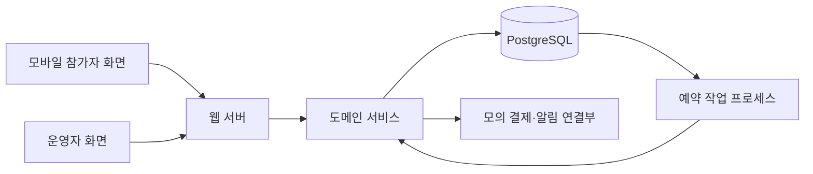

# 우연한 식탁 MVP 구현·배포·작업 계획

작성일: 2026-10-15. 갱신일: 2026-10-16. 상태: 기본 틀 소스 구현 및 검토 진행, 실제 DB·브라우저·배포 검증 대기. [요구사항 요약](kickoff_summary.md)과 [검증 결과](docs/archive/verification_report.md)를 바탕으로 작성했다. 현재 실행 방법은 [README](README.md), 이번 범위와 완료 판정은 [기반 구현 계획](docs/archive/foundation_acceptance.md)을 참고한다.

## 현재 계획 요약

| 항목 | 현재 정리한 방향 | 상태 |
|---|---|---|
| 제품 | 모바일 참가자 웹 + 같은 서비스의 운영자 웹 | 구현 목표 |
| 완료 기준 | 정상 흐름 자동 완료, 미해결 예외만 운영자 처리 큐로 전달 | PRD 기반 필수 |
| 주요 흐름 | 신청·모의 결제 → 자동 매칭·재배치·확정 → 식당·단체방·안내 → 참석·피드백 → 다음 매칭 | 구현 목표 |
| 기술 | Next.js + TypeScript + PostgreSQL | 현재 설계의 추천 기준안 |
| 자동화 | 웹과 코드를 공유하는 별도 Node 작업 프로세스 + DB 예약 작업 | 현재 설계안 |
| 외부 배포 | Railway 한 프로젝트의 웹·작업 프로세스·PostgreSQL 3개 서비스 | 현재 배포 추천안 |
| 개발 DB | 로컬 Docker PostgreSQL, 제출용 DB와 분리 | 현재 설계안 |
| 작업 관리 | Blaybus 워크 8개·태스크 49개, 실제 시간·산출물 기록 | 작성한 작업 계획 |
| 마감 | 10/21 23:59 공식 제출, 18:00 내부 제출 목표 | 공식 일정 + 내부 목표 |
| 유지 | 10/29 결과 안내까지 제출 링크 유지 | 행사 안내 기준 |

기술·배포안은 지금까지 제안한 계획의 기준이다. 계정·요금제 선택, 유료 리소스 생성, 실제 배포는 아직 진행하지 않았다. 불명확한 운영 정책과 세부 도구는 아래 미정 항목으로 남긴다.

## 1. 만들 제품과 완성 기준

참가자는 모바일 웹에서 신청·결제·매칭 상태·모임·피드백을 이용한다. 운영자는 같은 서비스의 `/admin`에서 회차·식당을 설정하고 자동 처리 결과와 예외를 확인한다.

완료 시연은 다음 네 흐름으로 구성한다.

1. **정상 참가**: 신청 → 모의 결제 → 서버 예약 실행 → 4~6인 자동 확정 → 식당·단체방·큐레이션 → 리마인드·대화 콘텐츠 → 체크인·피드백.
2. **재배치**: 최초 조합 실패 → 동의한 다른 날짜·지역에서 재조합 → 필수 조건과 최소 점수 검증 → 자동 확정.
3. **미매칭 해결**: 대안 제시 → 참가자의 일정 이동·이용권 보관·모의 환불 선택 → 선택한 결과 저장.
4. **피드백 효과**: 1차 만남과 비선호·차단 기록 → 2차 매칭 → 달라진 구성과 이유 확인.

모든 흐름은 서버와 DB 상태로 이어진다. 운영자 개입 없이 정상 흐름이 진행되고, 미해결 오류와 안전 문제는 처리 큐에 남는다.

## 2. 기술 구성

지금까지 제안한 Next.js·TypeScript 중심 구성을 기준으로 한다. 별도 Spring Boot 백엔드에 대한 선호는 확인되지 않았으며, ORM·UI 라이브러리·인증 라이브러리와 구체적인 버전은 아직 선정하지 않았다.

| 영역 | 잠정 선택 | 선택 이유 |
|---|---|---|
| 참가자·운영자 화면 | Next.js + TypeScript | 한 저장소에서 화면과 서버 기능을 함께 개발 |
| 서버 | Next.js 서버 진입점 + 도메인 서비스 | 요청 검증·권한 확인과 실제 업무 로직을 분리 |
| 저장소 | PostgreSQL | 상태 전환·결제·중복 배치를 트랜잭션과 제약으로 관리 |
| 예약 작업 | 같은 코드베이스의 독립 Node 작업 프로세스 | 웹페이지가 닫혀 있어도 매칭·리마인드·재시도를 실행 |
| UI | 공통 입력·카드·상태·목록 컴포넌트 | 모바일 참가 화면과 운영자 목록을 빠르게 일관되게 구성 |
| 배포 | Railway 웹 서비스 + 상시 작업 서비스 + PostgreSQL | 한 프로젝트에서 배포·로그·내부 연결 관리 |

배포는 Railway 구성을 추천안으로 정리했다. 상세 서비스·DB·비용 계획은 11절을 참고한다. 초기 배포에서 상시 실행, 영구 저장, HTTPS, 로그, 재시작 정책을 확인한다. Next.js의 Node/Docker 배포 지원은 [공식 배포 문서](https://nextjs.org/docs/app/getting-started/deploying)에서 확인했다.

도메인 서비스는 `application`, `payment`, `matching`, `venue`, `chat`, `notification`, `feedback`, `safety`로 나눈다. 웹 요청과 예약 작업이 같은 서비스를 호출하게 한다.

## 3. 화면 구성

| 사용자 | 경로 초안 | 핵심 내용 |
|---|---|---|
| 참가자 | `/login` | 테스트 계정 로그인, 역할별 이동 |
| 참가자 | `/` | 현재 진행 단계, 다음 안내 시각, 해야 할 행동 |
| 참가자 | `/profile` | 기본 정보·관심사·성향·식사 조건·동의 |
| 참가자 | `/apply` | 날짜·지역 복수 선택 → 이용권 → 모의 결제 |
| 참가자 | `/applications/[id]` | 신청·결제·매칭 상태, 실패 이유, 이동·보관·환불 |
| 참가자 | `/tables/[id]` | 모임 정보·제한된 참가자 소개·큐레이션·체크인 |
| 참가자 | `/tables/[id]/chat` | 참가자 메시지·시스템 공지·대화 콘텐츠 |
| 참가자 | `/tables/[id]/feedback` | 만족도·사람별 선호·신고 |
| 참가자 | `/history` | 참가 이력·피드백 제출 여부·다음 일정 추천 |
| 운영자 | `/admin` | 처리할 예외 우선 표시, 자동화 현황·지표 |
| 운영자 | `/admin/events`, `/admin/venues` | 회차·모집 마감·식당·수용량 설정 |
| 운영자 | `/admin/applications`, `/admin/match-runs` | 신청·결제·환불·매칭 결과·테이블·내보내기 |
| 운영자 | `/admin/exceptions`, `/admin/safety` | 실패 재처리·안전 검토·조치 이력 |
| 운영자 | `/admin/operations` | 알림 이력·참석·피드백·메시지 템플릿 조회·설정 |

참가자 홈은 화면 수보다 현재 상태와 다음 행동을 명확히 하는 데 집중한다. 단체방은 처음에는 짧은 주기로 새 메시지를 조회하는 방식으로 연결한다. 모바일 푸시는 권한 요청·구독·발송·실패 재시도를 별도 검증하며, 앱 내 알림도 항상 저장한다.

## 4. 데이터와 중복 방지

| 묶음 | 데이터 | 주요 책임 |
|---|---|---|
| 사용자 | User, Session, Profile, Consent | 계정·역할·프로필·정책 동의 버전 |
| 모집 | MatchingBatch, EventSlot, Application, ApplicationOption | 공동 매칭 마감, 날짜·지역 후보, 유효 신청 |
| 결제 | Payment, Refund, Entitlement, EntitlementEntry | 모의 승인·환불, 이용권 보관·사용·복구 이력 |
| 매칭 | MatchRun, DiningTable, TableMember | 입력 스냅샷·규칙 버전·최종 구성·배치 이력 |
| 식당 | Venue, VenueInventory, VenueAssignment | 시간대별 수용량과 테이블 배정 |
| 모임 | ChatRoom, Message, Notification, Attendance | 제한된 대화방·안내·참석 상태 |
| 피드백 | Feedback, PersonPreference, SafetyReport | 만족도·비선호·신고·참가 제한 |
| 운영 | ScheduledJob, ExceptionCase, AuditLog | 예약·실패 복구·운영자 조치·변경 이력 |

- 신청·결제·매칭·참석은 PRD의 별도 상태값을 사용한다. 참가자 화면의 진행 단계는 이를 읽어 계산한다.
- 하나의 매칭 발표 마감에 여러 날짜·지역 회차를 묶는 `MatchingBatch`를 두어 복수 선택을 함께 최적화한다. 다음 모집 묶음으로의 이동은 참가자 선택으로 처리한다. 이는 초기 모집 운영안이다.
- 동일한 신청은 하나의 활성 테이블에만 배치한다. 같은 시간대의 사용자 중복 예약도 검사한다.
- 결제 요청 키·환불 요청 키·테이블별 방·시스템 메시지 발송 키에 유일성 제약을 둔다.
- 하나의 신청 해결 건에서 이동·보관·환불을 동시에 선택할 수 없도록 현재 상태와 버전을 잠그고 변경한다.
- 테이블 확정, 구성원 저장, 이용권 처리, 후속 작업 등록을 한 DB 트랜잭션으로 묶는다.
- 식당 수용량과 이용권 잔여량은 동시 요청에서도 초과 사용되지 않게 잠그고 갱신한다.
- 참가자용 응답에는 다른 사람의 연락처·신고·비선호·상세 점수를 넣지 않는다. 운영자 상세 조회도 서버에서 역할을 확인한다.

## 5. 매칭 엔진

### 5.1 필수 검증

결제/이용권 사용 자격, 유효 신청, 동의한 날짜·지역, 4~6명, 최고·최저 나이 차이 8살 이내, 차단·신고·비선호 관계 제외를 검사한다. 후보 생성과 최종 확정 직전에 모두 검사한다.

### 5.2 점수

성비·MBTI·관심사·희망 상대 성향·새로운 사람 비율을 각각 0~1로 계산하고 가중 합산한다. 초기 가중치와 최소 점수는 설정값으로 두고 MatchRun에 버전을 보존한다. 구체적인 값과 MBTI 평가식은 데모 데이터 비교 후 정하며, 주최 측이 제공한 검증된 궁합 공식으로 표현하지 않는다.

관심사는 태그 집합의 겹침, 상대 성향은 참가자별 선호와 상대 프로필의 일치, 이전 만남은 실제 테이블 이력으로 계산한다. 불명확한 MBTI는 데이터 검토 대상으로 남기고 임의 유형으로 확정하지 않는다. 형식 오류로 정상 매칭이 불가능한 신청은 원인을 표시한다.

### 5.3 탐색과 재배치

1. 모집 묶음의 유효 후보·신청 옵션·비선호 관계를 읽고 입력 스냅샷을 저장한다.
2. 희망 회차가 적은 사람과 조합 가능한 상대가 적은 사람부터 배치를 시도한다.
3. 날짜·지역·나이 범위로 후보를 좁히고 탐색 개수와 시간을 제한해 4~6인 조합을 만든다.
4. 여러 시작 순서로 탐색하고, 미배치자 삽입·인원 교환·미완성 테이블 병합을 시도한다.
5. 필수 조건·최소 점수를 만족하는 결과 중 **배치 인원 수 → 전체 품질 점수** 순으로 비교한다.
6. 최종 저장 전에 최신 취소·결제·차단 상태를 다시 읽어 검사한다. 변경 충돌은 다시 계산한다.
7. 실패자는 참가자 동의 범위 안에서 재배치하고, 남으면 대안 선택 상태로 전환한다.

294개 응답 전체의 모든 4~6인 조합을 생성하는 방식은 피한다. 제한된 탐색은 전역 최적해를 보장하지 않으므로, 작은 검증 사례의 최적 결과와 비교하고 충분한 실행 시간 안에서 품질을 측정한다. 동일 입력·규칙·시드로 결과를 재현할 수 있게 한다.

7명은 4+3 또는 5+2처럼 잔여 인원이 생길 수 있다. 8살·인원·제외 관계를 완화해 전원 확정하지 않는다.

## 6. 자동화와 복구

| 작업 종류 | 실행 시점 | 처리 |
|---|---|---|
| MATCH_BATCH | 모집 묶음 매칭 마감 | 후보 구성·재배치·자동 확정 |
| PROVISION_TABLE | 테이블 확정 | 식당 배정·단체방·확정 공지 |
| REMIND_EVENT | 행사 1일 전 | 모임 정보·정책 안내 |
| POST_CONTENT | 행사 시작 | 맞춤 주제 최소 3개·아이스브레이킹 |
| CLOSE_ATTENDANCE | 체크인 마감 | 미체크인 노쇼 후보 생성 |
| REQUEST_FEEDBACK | 행사 종료 | 피드백 요청·미응답 1회 리마인드 |
| PROCESS_REFUND | 참가자 환불 선택 | 모의 환불·완료 알림 |

예약 작업은 DB에 실행 시각·상태·시도 횟수·다음 재시도·점유 만료 시각을 저장한다. 작업 프로세스가 만료된 점유를 회수하고 재시작 후 밀린 작업을 처리한다. DB 예약 시각을 기준으로 실행하므로 참가자가 웹을 열어 놓을 필요가 없다.

작업 획득은 짧은 트랜잭션에서 `FOR UPDATE SKIP LOCKED`로 처리하는 안을 사용한다. PostgreSQL은 이를 큐 형태의 테이블에서 여러 소비자의 잠금 경합을 줄이는 용도로 설명한다([공식 문서](https://www.postgresql.org/docs/current/sql-select.html)). 외부 호출을 기다리는 동안 DB 잠금을 유지하지 않는다.

전달은 재시도가 가능한 방식으로 설계하고, 각 처리기가 동일 작업을 여러 번 받아도 업무 결과는 한 번만 반영되도록 한다. 반복 실패는 예외 큐에 보내며 운영자 재처리도 같은 중복 방지 키를 사용한다.

UTC로 저장하고 화면·모집 정책은 Asia/Seoul로 표시한다. 행사 일정이 변경되면 이전 버전의 미발송 예약을 무효화하고 새 예약을 만든다.

## 7. 원본 데이터와 데모

원본 Excel은 보존하고 정규화 결과와 오류 목록을 별도 생성한다. 가명을 사용자 고유 ID로 사용하지 않으며 동일 응답 후보를 자동 삭제하지 않는다. 연락처·직업·출생연도·결제·참석·피드백은 원본에서 복원할 수 없는 항목으로 분류한다.

통제 가능한 데모 묶음을 따로 만든다.

| 묶음 | 검증 목적 |
|---|---|
| 정상 확정 | 4~6인 구성·식당·단체방·안내 |
| 재배치 | 부족한 조합이 다른 동의 지역·날짜에서 확정 |
| 미매칭 해결 | 이동·보관·환불을 서로 다른 신청으로 각각 시연 |
| 필수 조건 경계 | 인원 3/4/6/7, 나이 차이 8/9, 미결제·제외 관계 |
| 피드백 반영 | 동일 후보 조건에서 이전 만남·비선호 반영 전후 비교 |
| 복구 | 중복 실행·재시작·발송 실패·환불 실패 |

시연에서는 별도 데모 공간의 논리 시각을 앞으로 이동해 같은 예약 작업을 실행한다. 실제 서비스 시각·다른 심사자의 데이터와 분리하고, 운영자만 조작하게 한다. 일반 모집은 실제 서버 시각으로 자동 실행되는 것도 별도 확인한다.

## 8. 구현 순서와 날짜별 통과 기준

| 단계 | 목표일 | 구현 순서 | 통과 기준 |
|---|---|---|---|
| 기획·기반 | 10/15 | 정책 가정 → 상태·데이터 → 공통 화면 → 계정·DB | 상태 전이와 주요 화면 경로 확정 |
| 첫 배포 | 10/16 | 회차·식당 설정 → 프로필·신청 → 모의 결제 → 예약 작업 골격 | 외부 URL에서 신청 저장, 웹을 닫아도 예약 작업 실행 |
| 매칭 | 10/17 | 필수 검증 → 점수 → 후보 구성 → 실행 이력 | 정상·경계 데이터에서 결과와 이유 확인 |
| 첫 전체 흐름 | 10/18 | 재배치·자동 확정 → 식당·방·공지 → 실패 해결 | 신청부터 모임 안내 및 미매칭 해결까지 DB로 연결 |
| 참가 후 흐름 | 10/19 | 리마인드·콘텐츠 → 체크인·피드백 → 다음 일정 | 행사 전·중·후 예약과 피드백 저장 시연 |
| 품질 완성 | 10/20 | 다음 매칭 반영 → 운영자 예외·지표 → 모바일·권한·복구 검증 | 네 가지 완료 시연 통과, 필수 기능 동결 |
| 제출 | 10/21 | 중대 오류 수정 → 계정·시연 안내 → 기록 정리 → 제출 | 내부 목표 18:00 제출, 공식 마감 23:59 |

각 단계에서 화면·업무 로직·저장·오류 처리를 함께 완성한다. 화면 전체를 먼저 만들고 마지막에 서버를 연결하는 순서로 진행하지 않는다. Blaybus에는 해당 단계의 설계 메모·화면·검증 결과와 실제 작업 시간을 연결한다.

## 9. 일정이 밀릴 때의 조정 순서

기본 매칭·자동 예약 실행·상태 유지·피드백 반영·미매칭 해결은 완료 기준으로 유지한다. 화면 애니메이션, 고급 차트, 채팅의 실시간 전송 방식, 복잡한 콘텐츠 편집기는 단순화한다. PG·식당 예약은 허용된 모의 연동으로 진행한다. 추천 가중치 자동 학습은 P2로 남긴다.

푸시를 앱 내 알림만으로 대체한 경우처럼 P0 요구사항을 충족하지 못한 항목은 숨기지 않고 미완료로 표시한다. 일정 조정은 검증을 위해 필요한 시간과 함께 기록한다.

## 10. 착수 전에 정할 항목

- Next.js 기준안에 대한 선호 변경 여부, ORM·인증·UI 도구와 버전.
- 회차별 신청·매칭 마감과 식사 시작·종료 시각. 시간대는 UTC 저장·Asia/Seoul 표시를 현재 설계안으로 사용.
- 자발적 취소 제한 시각과 시스템 미매칭 환불의 관계.
- 체크인 허용 시간, 노쇼 후보의 운영자 확인 방식.
- 이용권 상품·사용 시점·보관·복구 및 모의 환불 범위.
- 매칭 초기 점수식·최소 점수·불명확한 프로필 처리.
- Railway 계정·요금제·예산, 배포 저장소와 환경변수, 백업·복원 방식.

불명확한 운영 정책은 검증 결과 문서의 질문을 바탕으로 확인한다. 답변 전 필요한 구현은 명시된 임시 설정으로 분리하고 변경 이력을 남긴다.

## 11. 외부 배포와 DB 운영

### 11.1 Railway 서비스 구성

하나의 Railway 프로젝트와 같은 배포 환경에 아래 세 서비스를 둔다. 웹과 작업 서비스는 같은 저장소·업무 로직을 사용하고 실행 명령을 분리한다. 프로덕션 환경을 준비한 뒤 GitHub 자동 배포 또는 CLI 배포 중 실제 접근 가능한 방식을 선택한다.

| 서비스 | 담당 기능 | 접근 |
|---|---|---|
| `todaytable-web` | 참가자·운영자 화면과 서버 API | HTTPS 웹 주소 공개 |
| `todaytable-worker` | DB 예약 작업 조회, 자동 매칭·안내·재시도·환불 | 공개 주소 없이 내부 실행 |
| `todaytable-db` | PostgreSQL과 영구 데이터 볼륨 | 웹·작업 서비스가 내부 주소로 연결 |

세 서비스는 같은 지역에 둔다. 현재 지역 추천은 싱가포르이며, 실제 생성 시 제공 여부를 확인한다. Railway는 싱가포르 배포 지역과 동일 프로젝트 환경의 비공개 통신을 지원한다([지역 문서](https://docs.railway.com/deployments/regions), [내부 연결 문서](https://docs.railway.com/networking/private-networking)).

제출·심사 기간에는 웹·작업·DB의 절전 기능을 끄는 안으로 진행한다. 브라우저 접속 없이 작업이 실행되고, 첫 접속 시 지연을 줄이는 것이 목적이다. Railway의 절전 동작은 [Serverless 문서](https://docs.railway.com/deployments/serverless)를 기준으로 확인한다.

### 11.2 개발용 DB와 제출용 DB

| 환경 | 구성 | 용도 |
|---|---|---|
| 개발 | 로컬 Docker PostgreSQL | 기능 개발·초기화·실패 재현 |
| 제출 | Railway PostgreSQL | 공개 앱과 심사용 데이터 유지 |

DB 구조는 마이그레이션 파일로 관리하고, 배포 시 한 곳에서 한 번 적용한다. 웹·작업 서비스가 동시에 구조 변경을 실행하지 않도록 배포 순서를 정한다. 초기 데이터 생성은 별도 명령으로 분리하며, 서버 시작마다 데이터를 초기화하지 않는다.

웹·작업 서비스는 서버 전용 환경변수로 DB에 접속한다. 브라우저에는 DB 연결 문자열을 전달하지 않는다. 개발·제출용 연결 정보를 분리하고 각 프로세스의 연결 풀은 작은 크기에서 시작해 사용량을 확인한다.

Railway PostgreSQL은 프로젝트 내 PostgreSQL 서비스와 저장소를 구성하는 방식이다. 백업·복원 설정을 직접 확인한다. 일일 백업과 최종 제출 전 백업을 준비하고 복원 절차를 검증한다([PostgreSQL 안내](https://docs.railway.com/databases/postgresql)).

### 11.3 예상 비용과 유지 기간

2026-10-15 대화에서 확인한 Railway 공식 요금은 Hobby 월 최소 **$5**, 월 사용료 **$5 포함**, 포함량 초과분 추가 청구 방식이다. $5로 세 서비스를 무제한 실행한다는 의미는 아니다([공식 요금](https://docs.railway.com/pricing/plans)).

초기 소규모 운영 예산은 **월 $10~20 정도의 추정치**로 잡는다. 실제 비용은 웹·작업·DB 메모리, CPU, 저장소, 통신 사용량으로 달라지므로 초기 배포 후 대시보드에서 확인하고 예산 알림을 설정한다. 실제 결제·요금제 변경은 아직 하지 않았다.

제출 후 10/29 결과 안내까지 링크·DB·작업 프로세스를 유지한다. 심사 중 배포는 주요 오류 수정에 한정하고, 데이터 초기화와 시연 데이터 변경이 다른 사용자의 진행을 지우지 않도록 한다.

### 11.4 다른 구성과 비교한 이유

Vercel은 Next.js 배포 대안이다. 다만 Hobby 내장 Cron은 작업별 하루 한 번 실행과 실행 시각 정확도 제한이 있으므로, 이번 계획에는 별도 예약 실행 수단이 필요하다([공식 제한](https://vercel.com/docs/cron-jobs/manage-cron-jobs)). 현재는 예약 작업 프로세스까지 한곳에서 운영하는 Railway안을 추천한다.

### 11.5 구축 순서와 확인 기준

1. 로컬 PostgreSQL과 마이그레이션, 초기 데이터 생성 명령을 준비한다.
2. Railway 프로젝트·PostgreSQL·영구 볼륨을 구성한다.
3. 마이그레이션을 적용하고 제출용 기본 데이터를 명시적으로 넣는다.
4. 웹 서비스를 배포하고 외부 URL에서 로그인·신청 저장을 확인한다.
5. 작업 서비스를 별도로 배포하고 같은 DB에 연결한다.
6. 웹페이지를 닫아도 예정된 작업이 실행되는지 확인한다.
7. 웹·작업 서비스를 재시작해 데이터 유지·작업 재개·중복 방지를 확인한다.
8. HTTPS·권한·로그·비용·백업과 복원 절차를 확인한다.

## 12. Blaybus 워크·태스크 계획

큰 틀인 워크는 직접 만들고 각 워크의 AI 기능으로 태스크를 생성하는 방식으로 정리했다. 기존 워크와 태스크는 재사용하고 실제 기록 시간·진행 상태를 보존한다. 아래 목록은 계획이며, 구현 완료나 시간 기록을 소급해서 생성하지 않는다.

기존 화면의 10/22 목표일은 제출 기한 이후이므로 대상 작업에 맞게 수정한다. 프로젝트 기간은 10/15~10/21이며 최종 제출 내부 목표는 10/21 18:00이다.

| 워크 | 기간 | 태스크 수 |
|---|---|---|
| 해커톤 강의 확인 및 전체적인 계획 짜기 | 10/15 | 6 |
| 개발 환경 구축 및 참가 신청 기능 구현 | 10/15~10/16 | 7 |
| 자동 매칭 엔진과 재배치 구현 | 10/17~10/18 | 7 |
| 식당 배정과 단체방 및 자동 안내 구현 | 10/18~10/19 | 5 |
| 미매칭 해결과 일정 이동 및 자동 환불 구현 | 10/18~10/19 | 5 |
| 참석과 피드백 및 다음 매칭 연결 | 10/19~10/20 | 6 |
| 운영자 관리 화면과 자동화 모니터링 구현 | 10/16~10/20 | 6 |
| 전체 검증과 최종 배포 및 제출 준비 | 10/20~10/21 | 7 |
| **합계** | **7일** | **49** |

### 워크 1. 해커톤 강의 확인 및 전체적인 계획 짜기

- 10/15 — 해커톤 강의 내용 확인: 일정·배점·제출 방법·운영 문제를 요약한다.
- 10/15 — PRD와 제공 자료 검토 및 요구사항 목록 정리: 기존 `새로운 태스크`를 변경하고 P0/P1/P2와 미정 정책을 정리한다.
- 10/15 — 앱웹 핵심 기능과 MVP 범위 정하기: 기존 태스크를 유지하고 정상·실패 시연 범위를 정한다.
- 10/15 — 개발 일정과 우선순위 계획하기: 기존 태스크를 유지하고 날짜별 통과 기준을 정한다.
- 10/15 — 참가자와 운영자의 화면 흐름 설계하기: 사용자 흐름도와 화면 초안을 만든다.
- 10/15 — 데이터 구조와 상태 전이 및 미정 정책 설계하기: 데이터 모델·상태 전이표·정책 가정을 남긴다.

### 워크 2. 개발 환경 구축 및 참가 신청 기능 구현

- 10/15 — 프로젝트 구조와 개발 환경 구성하기: 로컬 실행과 환경변수 예시·실행 가이드를 준비한다.
- 10/16 — 데이터베이스와 테스트 데이터 구성하기: 데이터 구조·초기화·정규화·시연 데이터를 준비한다.
- 10/16 — 참가자와 운영자 테스트 로그인 구현하기: 로그인·로그아웃·역할별 접근을 확인한다.
- 10/16 — 프로필과 매칭 선호 입력 기능 구현하기: 기본 정보·성향·식사 조건·동의의 검증과 저장을 연결한다.
- 10/16 — 모집 일정과 지역 선택 및 신청 기능 구현하기: 복수 선택·신청 저장·중복 제출 방지를 구현한다.
- 10/16 — 이용권 선택과 모의 결제 및 신청 상태 구현하기: 결제 성공·실패·정책 고지·상태 표시를 연결한다.
- 10/16 — 초기 버전 배포와 데이터 유지 확인하기: 외부 URL 접속과 재접속 후 저장 상태를 확인한다.

### 워크 3. 자동 매칭 엔진과 재배치 구현

- 10/17 — 매칭 후보군과 필수 조건 검증 구현하기: 결제·날짜·지역·인원·연령·제외 관계를 검사한다.
- 10/17 — 매칭 점수와 최소 확정 기준 구현하기: 점수·임계값과 초기 가정을 문서화한다.
- 10/17 — 4~6인 테이블 자동 구성하기: 중복 배치 없이 유효 조합을 생성한다.
- 10/18 — 미완성 테이블 분리·병합·재배치 구현하기: 동의 범위 안에서 재배치하고 잔여 인원을 분류한다.
- 10/18 — 마감 시각 자동 실행과 자동 확정 구현하기: 수동 승인 없이 예약 실행·검증·확정한다.
- 10/18 — 매칭 결과 설명과 실행 이력 구현하기: 참가자 이유 설명과 운영자 상세 기록을 구분한다.
- 10/18 — 매칭 경계 조건과 중복 실행 검증하기: 3/4/6/7명, 나이 차이 8/9, 제외 관계·미결제·임계값·재실행을 검증한다.

### 워크 4. 식당 배정과 단체방 및 자동 안내 구현

- 10/18 — 식당 자동 배정과 확정 상세 화면 구현하기: 지역·시간·인원·수용량을 검사하고 식당 정보를 표시한다.
- 10/19 — 테이블 단체방 자동 생성과 참가자 초대 구현하기: 테이블별 방과 구성원 접근 제어를 구현한다.
- 10/19 — 확정 안내와 테이블 큐레이션 자동 게시하기: 시간·장소·정책·매칭 이유를 자동 게시한다.
- 10/19 — 행사 전 리마인드와 행사 중 대화 콘텐츠 자동화하기: D-1 안내와 시작 시 맞춤 주제 최소 3개를 예약한다.
- 10/19 — 알림 실패 재시도와 중복 발송 방지 검증하기: 반복 실패 예외와 푸시 권한 거부 시 앱 내 안내를 확인한다.

### 워크 5. 미매칭 해결과 일정 이동 및 자동 환불 구현

- 10/18 — 매칭 실패 이유와 대체 일정 제안 구현하기: 실패 이유와 다음 선택지를 한 화면에 표시한다.
- 10/19 — 참가자 동의에 따른 일정 이동 구현하기: 기존 결제를 유지하고 새 회차 대기로 전환한다.
- 10/19 — 이용권 보관과 다음 신청 연결 구현하기: 보관·사용·복구 이력과 중복 차감 방지를 구현한다.
- 10/19 — 모의 자동 환불과 실패 예외 처리 구현하기: 요청·처리·완료와 실패 큐·중복 방지를 연결한다.
- 10/19 — 취소 정책과 확정 후 인원 변경 대응 구현하기: 취소 사유·잔여 인원·필수 조건을 재검증한다.

### 워크 6. 참석과 피드백 및 다음 매칭 연결

- 10/19 — 체크인과 참석·노쇼 후보 기록 구현하기: 참석 상태와 운영자 확인 후보를 구분한다.
- 10/19 — 모임 만족도와 재참여 의향 수집하기: 테이블·대화·식당 평가와 재참여 의향을 저장한다.
- 10/19 — 사람별 선호와 비선호 수집하기: 선택 내용을 비공개로 저장한다.
- 10/20 — 안전 신고와 차단 및 운영자 조치 연결하기: 매칭 분리와 경고·참가 제한 이력을 연결한다.
- 10/20 — 이전 만남과 피드백을 다음 매칭에 반영하기: 동일 후보 조건에서 결과 변화를 비교한다.
- 10/20 — 참가 이력과 다음 일정 추천 구현하기: 이력·추천·재신청과 미응답 1회 리마인드를 연결한다.

### 워크 7. 운영자 관리 화면과 자동화 모니터링 구현

- 10/16 — 회차와 모집 마감 및 식당 재고 관리 구현하기: 참가 신청·매칭에 필요한 사전 설정을 제공한다.
- 10/18 — 신청자와 결제 및 환불 조회 구현하기: 신청·결제·환불·이용권 처리 상태를 조회한다.
- 10/18 — 매칭 실행과 테이블 상세 모니터 구현하기: 결과·재배치·식당·방·안내 상태를 조회한다.
- 10/20 — 예외 처리함과 처리 이력 구현하기: 원인·조치·처리 상태와 재시도를 기록한다.
- 10/20 — 참석·피드백·안내 발송 내역 조회 구현하기: 확인 후보·신고·발송 실패를 찾을 수 있게 한다.
- 10/20 — 운영 지표와 CSV 내보내기 구현하기: 분모·분자가 명확한 지표와 참가자·테이블 출력을 제공한다.

### 워크 8. 전체 검증과 최종 배포 및 제출 준비

- 10/20 — 정상 참가 시나리오 전체 검증하기: 신청부터 피드백·다음 매칭까지 PRD 완료 조건에 대조한다.
- 10/20 — 실패·안전·중복 실행 시나리오 검증하기: 조건 충돌·미매칭 선택·신고·재시도 결과를 확인한다.
- 10/20 — 모바일 사용성과 권한 및 입력 오류 점검하기: 최초 신청 5분 목표·오류 안내·역할별 공개 범위를 확인한다.
- 10/21 — 주요 오류 수정과 최종 배포하기: 외부 URL에서 재현하고 데이터 유지·예약 작업을 확인한다.
- 10/21 — 심사용 테스트 계정과 데모 시나리오 준비하기: 계정·접속 방법·시연 순서·시간 이동 방식을 문서화한다.
- 10/21 — Blaybus 작업 기록과 산출물 정리하기: 실제 시간·완료 상태·변경 이유·화면·검증 결과를 정리한다.
- 10/21 — 제출 링크와 계정 확인 후 최종 제출하기: 18:00 내부 목표로 프로그램 제출 탭에 제출하고 완료 화면을 보관한다.

각 태스크 설명에는 작업·완료 조건·산출물을 넣고, 수행 후 `작업 내용 / 결정 이유 / 확인 결과 / 산출물`을 남긴다. 동일 작업의 다음 세션은 기존 태스크에 기록한다. 생성된 계획이 Blaybus 웹에 실제 등록됐는지는 아직 확인하지 않았다.

## 13. 현재 완료된 준비와 다음 착수 순서

완료된 준비는 킥오프·PRD·온보딩·가상 데이터 검토, 자료 정리, 요약문 오류 수정, 검증 결과 작성, 작업 계획과 구현·배포 방향 정리다. 2026-10-16에는 이 폴더에 Next.js 앱, PostgreSQL 스키마·시드, 별도 작업 프로세스와 테스트 소스를 추가했다. 실제 DB 인스턴스와 외부 배포는 아직 구성하지 않았다.

첫 구현 단위는 **로그인 → 프로필·일정 신청 → 모의 결제 → DB 예약 작업 실행**이다. 소스 구현 후 실제 PostgreSQL에서 마이그레이션·신청·작업 실행·재시작을 확인해야 한다. 현재 환경에는 DB/Docker와 일부 의존성이 없고 TCP 소켓 생성도 제한돼 있어 이 실행 검증은 남아 있다. 이 단계를 검증하고 초기 버전을 배포한 다음 매칭 엔진과 모임 안내·피드백을 순서대로 연결한다.

## 14. 실제 신청서 반영 사항 (2026-10-16 추가)

사용자가 전달한 [실제 신청서 본문과 선택지](application_form_reference.md)를 기존 요구사항에 추가했다. 아래는 구현 계획의 보충이며 구현 완료를 의미하지 않는다. 앞선 기술·배포안과 PRD의 자동화 완료 기준은 유지한다.

1. **서비스 소개·비용 안내**: 친구와 새로운 관계를 위한 저녁 모임임을 설명하고, 연애 매칭을 보장하지 않는다는 안내를 둔다. 참가권 비용과 별도 현장 식비를 신청·결제 화면에서 구분한다.
2. **프로필 입력**: 신청서의 관심사 10종·본인 성향 6종·희망 상대 성향 6종·식사 가격대 3종을 초기 선택지로 활용한다. 원문 목록은 참고 자료를 따른다. PRD의 출생연도·알레르기 입력과 개인정보·운영 정책 동의도 반영한다. Instagram 필수 수집은 PRD 밖의 추가 정책으로 남기며 자동 추가하지 않는다.
3. **회차·지역 설정**: 목요일 19:30과 홍대/합정·잠실·강남/신논현·을지로/종로를 초기 설정 참고값으로 사용한다. 기타 희망 지역은 기존 회차와 연결 가능한지 검증하고, 회차가 없는 지역의 신청이 자동 확정되는 것으로 표현하지 않는다. 신청서의 네 날짜는 참고 목록이며 동적으로 관리한다.
4. **상품·이용권**: 실제 신청서의 1회권 8,000원·3회권 15,000원(2개월 이내 사용)·기존 3회권 사용 흐름을 상품 설계 근거에 추가한다. PRD의 구독권과 관계, 채택할 상품 범위, 유효기간 시작·만료 기준, 예약·차감·취소 복구·보관 규칙은 구현 전 임시 정책을 명시해야 한다. 3회권에 자동 갱신을 임의로 추가하지 않는다.
5. **자동 매칭·안내**: 기존 수기 운영의 직접 선정·입금 확인·문자·오픈 채팅방을 MVP에서는 모의 결제·예약 매칭·앱 내 단체방·알림으로 연결한다. 화요일 저녁~수요일 낮은 기존 안내 범위이며 정확한 신청·매칭 마감으로 확정하지 않는다. 정상 흐름의 수동 승인 단계를 추가하지 않는다.
6. **정책·안전**: 단순 변심 환불은 실제 신청서의 매칭·예약 완료 기준과 PRD의 행사 2일 전 기준을 대조하고, 시스템 미매칭 환불과 구분해 정한다. 식사 후 단체방 퇴장 허용도 PRD와 적용 기간을 확인한다. 부담 주는 행동·과도한 연락처 요구·노쇼 안내를 포함하고, 실제 참여 제한은 운영자 검토와 조치 이력에 연결한다.
7. **검증 범위 보충**: 관심사 항목 안의 쉼표(예: 운동의 세부 종목), 가격의 천 단위 쉼표를 복수 선택 구분자로 잘못 분리하지 않게 정규화한다. 참가비·식비 구분, 이용권 잔여량·만료, 모집이 없는 기타 지역, 연령 폭 8살 경계를 확인한다.

신청서에 나이 차이가 “최대 ±7~8세”로 표현돼 있어도 확정 검증은 **테이블 최고·최저 나이 차이 8살 이내**로 유지한다. 데이터는 나이가 아닌 출생연도를 새로 입력받는 PRD 흐름과 원본 응답을 구분하고, 원본의 나이를 특정 출생연도로 임의 변환하지 않는다.
